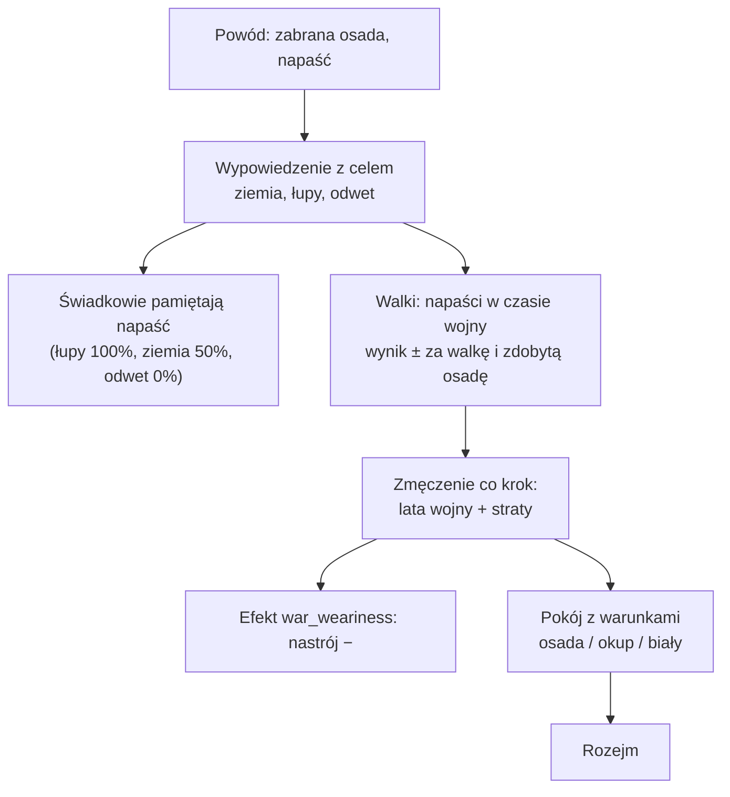

# Wojna (etap 4e)

**W jednym zdaniu:** wojna ma cel, wynik i zmęczenie, a kończy się pokojem z warunkami (ADR 0021, GDD 9.3).

**Faza tury:** 6. Walka (`WarSystem`), w krokach cywilizacji (ADR 0018). Wypowiedzenie wojny i pokój: faza decyzji (komendy dyplomaty).

**Stan:** PR 1 (cel, wynik, zmęczenie, pokój z warunkami). Wyprawy, uzbrojenie, bitwy, zaopatrzenie i dowódca w PR 2–4 (`docs/prompts/07-etap-wojna.md`).

## Dane wejściowe i wyjściowe
- Czyta: `data/war.json`, traktaty (`TreatyBook`), wspomnienia relacji, osady stron.
- Zmienia: pola wojny w traktacie (`Treaty.Goal`, `GoalSettlement`, `Score`, straty, zmęczenie), efekt `war_weariness` (nastrój), przy pokoju właściciela osady albo zapasy (okup).
- Publikuje: kronika (wypowiedzenie z celem, pokój z warunkami); Headless `--wars` (CSV).

## Przepływ

## Zasady i wzory
- Opisane w kolejnych PR-ach (tu dojdą liczby z `data/war.json`).

## Co erę (prośba Patryka z 2026-11-07)

Przy każdym etapie nowej ery (etapy 6–12) sprawdź i uzupełnij:

- [ ] **Uzbrojenie** (`data/war.json`, `armaments`): nowe poziomy z technologii ery (brąz, żelazo, stal, proch…), dobro, zużycie, procent siły.
- [ ] **Fachy wojska** (`data/skills.json`): np. kowal po wytopie metali, płatnerz, rusznikarz; wymogi ludzi w technologiach wojskowych.
- [ ] **Jednostki** (GDD 9.4): nowe rodzaje oddziałów ery (strzelcy, jazda, oblężnicze, łodzie).
- [ ] **Limity** (`data/eras.json`): limit wodza (`armyLimit`) i liczba ludzi na polu (`troopsPerCell`), czyli kiedy armia robi front.
- [ ] **Zaopatrzenie:** zasięg tragarzy, drogi i rzeki, wozy, tabory.
- [ ] **Mury i oblężenia** od ery z budynkami.
- [ ] **AI dowódcy:** nowe czynniki (jednostki, mury, morze) i sytuacje w `DeadValueTests`.
- [ ] **Dokumentacja:** ta strona, GDD 9.3–9.4, `docs/ai/`.

## Pliki danych
- `data/war.json` (PR 1).

## Testy
- `WarTests` (PR 1).
