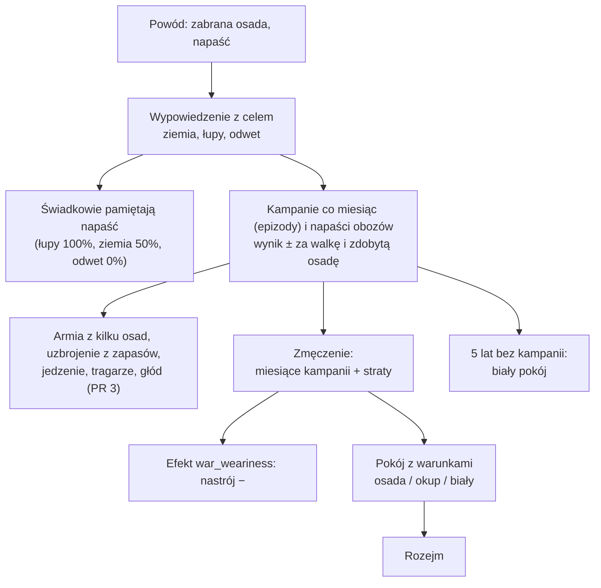

# Wojna (etap 4e)

**W jednym zdaniu:** wojna ma cel, wynik i zmęczenie, a kończy się pokojem z warunkami (ADR 0021, GDD 9.3).

**Faza tury:** 6. Walka (`WarSystem`), w krokach cywilizacji (ADR 0018). Wypowiedzenie wojny i pokój: faza decyzji (komendy dyplomaty).

**Stan:** PR 1 (cel, wynik, zmęczenie, pokój z warunkami), PR 2 (kampanie jako epizody z krokiem co miesiąc, `docs/systems/episodes.md`, ADR 0022) i PR 3 (uzbrojenie, armie z wielu osad, limity er, tragarze, głód). Bitwy w rundach, pełny dowódca i strojenie w PR 4–6 (`docs/prompts/07-etap-wojna.md`).

## Dane wejściowe i wyjściowe
- Czyta: `data/war.json`, traktaty (`TreatyBook`), wspomnienia relacji, osady stron.
- Zmienia: pola wojny w traktacie (`Treaty.Goal`, `GoalSettlement`, `Score`, straty, zmęczenie), efekt `war_weariness` (nastrój), przy pokoju właściciela osady albo zapasy (okup).
- Publikuje: kronika (wypowiedzenie z celem, pokój z warunkami); Headless `--wars` (CSV).

## Przepływ

## Zasady i wzory
- **Cel** (`WarGoal`, `DeclareWarCommand`): ziemia (osada wroga, którą znamy z mapy), łupy (zawsze można), odwet (tylko z powodem: napaść,
  agresja albo nasza osada u nich, `Treaties.HasGrievance`).
- **Agresja** (nowe wspomnienie `aggression`, `data/relations.json`: sympatia −30, zaufanie −15, 100 lat): ofiara i świadkowie (znają obie strony)
  pamiętają ją w procencie z celu: ziemia 100/50, łupy 100/100, odwet 50/0.
- **Wynik** (`Treaty.Score`, z perspektywy strony A, −100…+100, `Wars.RecordFight`): napaść w czasie wojny daje zwycięzcy +10, a zdobyta osada +15 więcej.
  Straty to ludzie zabici w walce (wojownicy obu stron i uciekający), liczone osobno dla stron.
- **Zmęczenie** (`Wars.ComputeWeariness`, co krok świata w `WarSystem`): `miesiące kampanii w tej wojnie × 5 + procent ludzi strony zabitych w wojnie × 3`, najwyżej 100 (od PR 2; w PR 1 liczyły się lata wojny).
- **Kampanie** (PR 2, `docs/systems/episodes.md`): armia maszeruje co miesiąc, walczy u celu i wraca z łupami; w wojnie o ziemię zdobyta wioska przechodzi z ludźmi.
- **Uzbrojenie** (PR 3, `armaments` w `data/war.json`): gołe ręce 50%, drewniane włócznie hartowane w ogniu 70% (ogień, 0,2 drewna na wojownika),
  proce 80% (garbarstwo, 0,1 skóry), włócznie i topory z kamiennym grotem 100% (obróbka krzemienia, 0,2 narzędzi kamiennych). Każdy wojownik
  bierze najsilniejszy poziom, którego technologię zna cywilizacja i na który jego osada ma jeszcze dobra; dobra zużywa przy wyjściu.
  Obrońcy walczą tym, na co pozwalają ich zapasy (bez zużycia), pozostali mieszkańcy gołymi rękami (25% z nich).
- **Siła w walce:** `wojownicy × uzbrojenie × morale` przeciw obronie; szansa = udział w sumie sił (strumień `combat`).
- **Armia z wielu osad** (PR 3): osada wyjścia i własne osady do 6 pól (`musterCells`), z każdej najwyżej 2/3 wojowników; najwyżej `armyLimit`
  wojowników (dane ery, 50 w erach 1–2); `troopsPerCell` (50) mówi, na ilu polach stoi armia (front; w erach 1–2 zawsze jedno pole).
- **Zaopatrzenie** (PR 3, `supply`): wojownik zjada 1 jedzenia na rok; armia bierze jedzenie na 3 miesiące (najwyżej połowę jedzenia każdej osady
  i tyle, ile uniesie). Gdy zostaje na mniej niż 2 miesiące, najbliższa własna osada z jedzeniem (do 12 pól) wysyła tragarzy (do 10% ludzi, którzy
  nie walczą, 10 jedzenia na osobę), którzy idą 4 pola na miesiąc za armią, oddają jedzenie i wracają do domu.
- **Głód** (PR 3): głodna armia traci 20 morale na miesiąc (najedzona odzyskuje 10), napada najbliższą znaną osadę wroga do 4 pól, biorąc
  najpierw jedzenie (nie tę samą dwa razy z rzędu), a przy morale poniżej 30 zawraca.
- **Ciche wygasanie** (PR 2): wojna, w której przez 5 lat nikt nie prowadził kampanii, kończy się białym pokojem (zegar robi krok dokładnie w tym miesiącu).
  Ludzie strony to jej ludność w chwili wypowiedzenia.
- **Nastrój:** każda cywilizacja w wojnie dostaje efekt `war_weariness` (nastrój wszystkich osad) = −największe zmęczenie × 20 / 100; trwa jeszcze
  jedną turę po końcu wojny.
- **Warunki pokoju** (`Wars.TermsFor`): przy wyniku co najmniej ±20 przegrany oddaje osadę, o którą była wojna o ziemię, a w innym razie płaci
  okup: `(|wynik| − 20 + 1) × 0,5%` każdego zapasu każdej swojej osady (1–40%), do największej osady zwycięzcy. Bliższy wynik: biały pokój.
- **Wykonanie** (`Wars.Keep`, przy podpisaniu): oddana osada przechodzi z ludźmi i fachowcami, roszczenia znikają. Rozejm (`TreatyKind.Peace`)
  zachowuje cel, wynik, straty, zmęczenie i warunki wojny (do raportu `--wars`).

## Co erę (prośba Patryka z 2026-11-07)

Przy każdym etapie nowej ery (etapy 6–12) sprawdź i uzupełnij:

- [ ] **Uzbrojenie** (`data/war.json`, `armaments`): nowe poziomy z technologii ery (brąz, żelazo, stal, proch…), dobro, zużycie, procent siły.
- [ ] **Fachy wojska** (`data/skills.json`): np. kowal po wytopie metali, płatnerz, rusznikarz; wymogi ludzi w technologiach wojskowych.
- [ ] **Jednostki** (GDD 9.4): nowe rodzaje oddziałów ery (strzelcy, jazda, oblężnicze, łodzie).
- [ ] **Limity** (`data/eras.json`): limit wodza (`armyLimit`) i liczba ludzi na polu (`troopsPerCell`), czyli kiedy armia robi front.
- [ ] **Zaopatrzenie:** zasięg tragarzy, drogi i rzeki, wozy, tabory.
- [ ] **Mury i oblężenia** od ery z budynkami.
- [ ] **AI dowódcy:** nowe czynniki (jednostki, mury, morze) i sytuacje w `DeadValueTests`.
- [ ] **Dokumentacja:** ta strona, GDD 9.3–9.4, `docs/ai/`.

## Pliki danych
- `data/war.json` (PR 1; `armaments`, `musterCells`, `minFoodMonths`, `supply` od PR 3).
- `data/eras.json`: `armyLimit`, `troopsPerCell` (PR 3).

## Testy
- `ArmyTests` (PR 3): dane uzbrojenia i limitów; najsilniejsze uzbrojenie z zapasów i zużycie dóbr; zbiórka z dwóch osad i powrót ocalałych
  do obu; 1/3 w domu każdej osady, odległość, limit wodza, front; tragarze dochodzą i wracają; głód łamie wyprawę; głodna armia napada wioskę;
  zapis z armią i tragarzami, migawka dla podglądu; dowódca zbiera armię z osad w pobliżu; błędy w danych.
- `EpisodeTests` (PR 2): kampanie co miesiąc, ciche wygasanie, odwrót przed silnym celem, 1/3 w domu, zapis w trakcie marszu.
- `WarTests` (PR 1): dane; cel, który da się nazwać; agresja u ofiary i świadków według celu; wynik i zmęczenie z lat i strat; spadek nastroju;
  zwycięzca bierze osadę, o którą była wojna; okup w wojnie o łupy; złe warunki odrzucone; zapis; błędy w danych.
- `TreatyTests`: wojny z celem „łupy” (tekst kroniki „for loot”).
