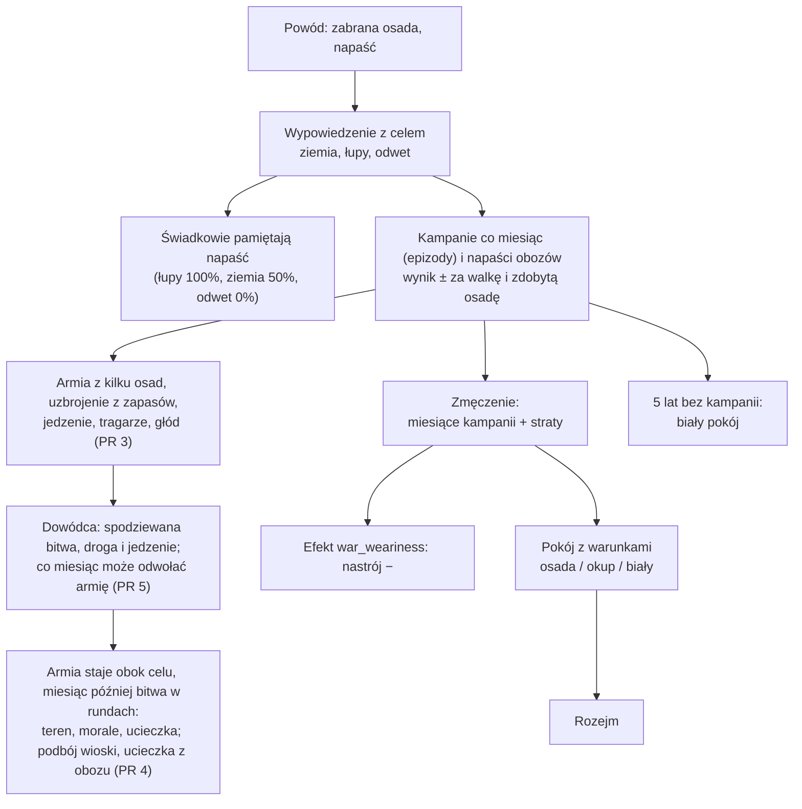

# Wojna (etap 4e)

**W jednym zdaniu:** wojna ma cel, wynik i zmęczenie, a kończy się pokojem z warunkami (ADR 0021, GDD 9.3).

**Faza tury:** 6. Walka (`WarSystem`), w krokach cywilizacji (ADR 0018). Wypowiedzenie wojny i pokój: faza decyzji (komendy dyplomaty).

**Stan:** PR 1 (cel, wynik, zmęczenie, pokój z warunkami), PR 2 (kampanie jako epizody z krokiem co miesiąc, `docs/systems/episodes.md`, ADR 0022) PR 3 (uzbrojenie, armie z wielu osad, limity er, tragarze, głód) PR 4 (bitwa w rundach, teren, podbój, ucieczka z obozu) i PR 5 (dowódca: bitwa w głowie, droga i jedzenie, odwołanie co miesiąc; opis w `docs/ai/11-dowodca.md`). Strojenie w PR 6 (`docs/prompts/07-etap-wojna.md`).

## Dane wejściowe i wyjściowe
- Czyta: `data/war.json`, traktaty (`TreatyBook`), wspomnienia relacji, osady stron.
- Zmienia: pola wojny w traktacie (`Treaty.Goal`, `GoalSettlement`, `Score`, straty, zmęczenie), efekt `war_weariness` (nastrój), przy pokoju właściciela osady albo zapasy (okup).
- Publikuje: kronika (wypowiedzenie z celem, pokój z warunkami); Headless `--wars` (CSV).

## Przepływ

## Zasady i wzory
- **Cel** (`WarGoal`, `DeclareWarCommand`): ziemia (osada wroga, którą znamy z mapy), łupy (zawsze można), odwet (tylko z powodem: napaść,
  agresja albo nasza osada u nich, `Treaties.HasGrievance`).
- **Agresja** (nowe wspomnienie `aggression`, `data/relations.json`: sympatia −30, zaufanie −15, 100 lat): ofiara i świadkowie (znają obie strony)
  pamiętają ją w procencie z celu: ziemia 100/50, łupy 100/100, odwet 50/0.
- **Wynik** (`Treaty.Score`, z perspektywy strony A, −100…+100, `Wars.RecordFight`): napaść w czasie wojny daje zwycięzcy +10, a zdobyta osada +15 więcej.
  Straty to ludzie zabici w walce (wojownicy obu stron i uciekający), liczone osobno dla stron.
- **Zmęczenie** (`Wars.ComputeWeariness`, co krok świata w `WarSystem`): `miesiące kampanii w tej wojnie × 0,6 + procent ludzi strony zabitych w wojnie × 3`, najwyżej 100 (od PR 2; w PR 1 liczyły się lata wojny; od etapu 6 PR 3b 0,6 zamiast 5 na miesiąc, bo armie idą ok. 9 razy wolniej).
- **Armia jako oddział** (etap 6 PR 3b, `docs/systems/units.md`): kampania prowadzi oddział armii, który idzie w taktach (wojownicy 15
  taktów na płaskie pole, 0,67 pola/s przy ×1; teren z biomów, A*). Wojownicy innych osad idą na zbiórkę jako własne oddziały. Armia
  staje, gdy cel jest w zasięgu jej rodzaju (`rangeCells`), i walczy miesiąc akcji później. Pobita armia ucieka (`Flee`) i nikt jej
  nie zawróci. Ocaleni odpoczywają w swoich osadach `restMonths` (6) miesięcy akcji, zanim osada znów kogoś wyśle. Tragarze to
  oddział (10 taktów na pole), który idzie za armią i wraca do domu. Wartości liczone na miesiąc kampanii przeskalowane do
  wolniejszego marszu: `carryFoodMonths` 3 → 36, `convoyBelowMonths` 3 → 18, `hungerMoralePerMonth` 20 → 3, `fedMoralePerMonth`
  10 → 2, `wearinessPerCampaignMonth` 5 → 0,6. Usunięte: `marchCellsPerMonth`, `convoyCellsPerMonth`.
- **Kampanie** (PR 2, `docs/systems/episodes.md`): armia maszeruje co miesiąc, walczy u celu i wraca z łupami; w wojnie o ziemię zdobyta wioska przechodzi z ludźmi.
- **Uzbrojenie** (PR 3, `armaments` w `data/war.json`): gołe ręce 50%, drewniane włócznie hartowane w ogniu 70% (ogień, 0,2 drewna na wojownika),
  proce 80% (garbarstwo, 0,1 skóry), włócznie i topory z kamiennym grotem 100% (obróbka krzemienia, 0,2 narzędzi kamiennych). Każdy wojownik
  bierze najsilniejszy poziom, którego technologię zna cywilizacja i na który jego osada ma jeszcze dobra; dobra zużywa przy wyjściu.
  Obrońcy walczą tym, na co pozwalają ich zapasy (bez zużycia), pozostali mieszkańcy gołymi rękami (25% z nich).
- **Siła w walce:** `wojownicy × uzbrojenie × morale` (głodna armia bez jedzenia × 75%) przeciw obronie z terenem.
- **Teren** (PR 4, `battle.terrain`): obrońcy +25% na wzgórzach, +50% w górach, +25% w lesie liściastym, tajdze, dżungli i na bagnach,
  +25%, gdy atakujący przychodzą przez rzekę (krawędź pola osady); procenty się sumują.
- **Bitwa w rundach** (PR 4, `Battles.Fight`, strumień `combat`): najwyżej 6 rund. W każdej rundzie strona zabija `siła × 10% × szczęście`
  ludzi (100 = jeden wojownik z kamiennym grotem; szczęście losowane z 50–150%, ułamek człowieka losowo). Każdy procent straconych ludzi
  w rundzie to −3 morale; strona z morale poniżej 40 ucieka (obie: ta z mniejszym morale) i traci jeszcze 10% ludzi w ucieczce. Gdy nikt
  nie ucieknie przez 6 rund, obrońcy się utrzymali. Obrońcy to wojownicy i 25% reszty mieszkańców (z morale 100); giną najpierw wojownicy.
- **Bitwa w czasie** (etap 6, decyzja Patryka z 2026-11-09): kampania przy celu przechodzi w fazę `Battle` i walczy **jedną rundę co
  `battle.roundTicks` (10) taktów**, czyli rundę na sekundę przy ×1 (najwyżej 6 s). Polegli każdej rundy giną od razu, więc armia
  maleje na mapie, a obrońców ubywa. W trakcie bitwy nikt nie może jej odwołać (ani dowódca, ani gracz) ani posłać na inny cel.
  Pokój albo utrata celu (osada pusta albo w innych rękach) przerywa bitwę: wojownicy wracają w porządku, a straty do tej chwili
  idą do wyniku wojny. Wzory rund są te same (`Battles.Begin` i `Battles.Round`; `Battles.Fight` i `Battles.Expect` liczą tak jak
  wcześniej). `roundTicks` = 0 rozgrywa całą bitwę naraz. Bitwa w toku jest w zapisie (format 35).
- **Atak** (PR 5; od PR 3b etapu 6: w zasięgu rodzaju armii): armia, która doszła do pola obok celu, atakuje w następnym miesiącu; do tego czasu jej dowódca może ją odwołać
  (`RecallCampaignCommand`, decyzja K2). Armia widzi osady do `armySightCells` (1) pola od siebie. Spodziewana bitwa dowódcy
  (`Battles.Expect`): te same rundy ze stałym szczęściem, 5 poziomów na stronę, 25 bitew, bez losowania.
- **Po bitwie** (PR 4): wygrana w wojnie o ziemię zabiera wioskę, o którą jest wojna, z ludźmi; ludzie pokonanego obozu uciekają z tym, co
  uniosą, do swojej najbliższej osady, a obóz zostaje pusty; w innym razie zwycięzcy biorą łupy. Wynik i straty idą do wojny
  (`Wars.RecordFight`), morale armii po bitwie zostaje.
- **Armia z wielu osad** (PR 3): osada wyjścia i własne osady do 6 pól (`musterCells`), z każdej najwyżej 2/3 wojowników; najwyżej `armyLimit`
  wojowników (dane ery, 50 w erach 1–2); `troopsPerCell` (50) mówi, na ilu polach stoi armia (front; w erach 1–2 zawsze jedno pole).
- **Zaopatrzenie** (PR 3, `supply`; strojenie PR 6): wojownik zjada 1 jedzenia na rok; armia bierze jedzenie na 3 miesiące (najwyżej połowę jedzenia
  każdej osady i tyle, ile uniesie). Gdy armia zbiera się w osadzie wyjścia, je z jej zapasów, a nie z plecaków (PR 6). Gdy jedzenia zostaje na mniej
  niż 3 miesiące, tragarzy wysyła ta własna osada do 12 pól, która może dać najwięcej jedzenia (do 10% ludzi, którzy nie walczą, 10 jedzenia
  na osobę; PR 6, wcześniej najbliższa, często prawie pusta). Tragarze idą 6 pól na miesiąc za armią, oddają jedzenie i wracają do domu.
- **Głód** (PR 3): głodna armia traci 20 morale na miesiąc (najedzona odzyskuje 10), napada najbliższą znaną osadę wroga do 4 pól, biorąc
  najpierw jedzenie (nie tę samą dwa razy z rzędu), a przy morale poniżej 30 zawraca.
- **Ciche wygasanie** (PR 2): wojna, w której przez 5 lat nikt nie prowadził kampanii, kończy się białym pokojem (zegar robi krok dokładnie w tym miesiącu).
  Ludzie strony to jej ludność w chwili wypowiedzenia.
- **Nastrój:** każda cywilizacja w wojnie dostaje efekt `war_weariness` (nastrój wszystkich osad) = −największe zmęczenie × 20 / 100; trwa jeszcze
  jedną turę po końcu wojny.
- **Warunki pokoju** (`Wars.TermsFor`): przy wyniku co najmniej ±20 przegrany oddaje osadę, o którą była wojna o ziemię, a w innym razie płaci
  okup: `(|wynik| − 20 + 1) × 0,5%` każdego zapasu każdej swojej osady (1–40%), do największej osady zwycięzcy. Bliższy wynik: biały pokój.
- **Wykonanie** (`Wars.Keep`, przy podpisaniu): oddana osada przechodzi z ludźmi i fachowcami, roszczenia znikają. Rozejm (`TreatyKind.Peace`)
  zachowuje cel, wynik, straty, zmęczenie i warunki wojny (do raportu `--wars`).

## Co erę (prośba Patryka z 2026-11-07)

Przy każdym etapie nowej ery (etapy 6–12) sprawdź i uzupełnij:

- [ ] **Uzbrojenie** (`data/war.json`, `armaments`): nowe poziomy z technologii ery (brąz, żelazo, stal, proch…), dobro, zużycie, procent siły.
- [ ] **Fachy wojska** (`data/skills.json`): np. kowal po wytopie metali, płatnerz, rusznikarz; wymogi ludzi w technologiach wojskowych.
- [ ] **Jednostki** (GDD 9.4): nowe rodzaje oddziałów ery (strzelcy, jazda, oblężnicze, łodzie) jako wpisy w `units.json` (od etapu 6
  PR 3b: rola `army`, `requires`, prędkość, **zasięg walki** `rangeCells`, własny teren). Przy erach z prochem: sprawdzić, czy bitwa
  w rundach (`war.json` `battle`) ma dostać parametry na rodzaj (ogień z dystansu przed starciem, osłona, przewaga zasięgu).
- [ ] **Limity** (`data/eras.json`): limit wodza (`armyLimit`) i liczba ludzi na polu (`troopsPerCell`), czyli kiedy armia robi front.
- [ ] **Zaopatrzenie:** zasięg tragarzy, drogi i rzeki, wozy, tabory.
- [ ] **Mury i oblężenia** od ery z budynkami.
- [ ] **AI dowódcy:** nowe czynniki (jednostki, mury, morze) i sytuacje w `DeadValueTests`.
- [ ] **Dokumentacja:** ta strona, GDD 9.3–9.4, `docs/ai/`.

## Pliki danych
- `data/war.json` (PR 1; `armaments`, `musterCells`, `supply` od PR 3; `armySightCells` od PR 5).
- `data/ai.json` `commander` (PR 5): progi dowódcy (szansa 60%, straty 50%, zapas jedzenia 1 miesiąc, odwołanie poniżej 45%).
- `data/eras.json`: `armyLimit`, `troopsPerCell` (PR 3).
- `data/war.json` `battle` (PR 4): rundy, straty, szczęście, morale, ucieczka, głód, teren.

## Testy
- `WarTuningTests` (PR 6): tragarze z osady z największym zapasem; armia przy zbiórce je z zapasów domu; dowódca nie wysyła armii, której
  okolica nie wyżywi; przegrywający wysoko płaci okup za pokój; odrzucony pokój wraca po roku.
- `CommanderTests` (PR 5): spodziewana bitwa bez losowania jest blisko wyników prawdziwych bitew; dowódca nie wysyła armii na silniejszy cel
  ani dalej, niż starczy jedzenia; odwołuje armię, której jedzenie nie wystarczy na drogę; armia atakuje miesiąc po dojściu; odwołać może
  tylko właściciel. `DeadValueTests` ma sytuację wojny, w której każdy próg dowódcy zmienia decyzję.
- `BattleTimeTests` (etap 6): rundy po kolei dają tę samą bitwę co naraz; runda co sekundę, armia maleje, odwołanie niemożliwe;
  pokój w trakcie przerywa bitwę; bitwa w toku przetrwa zapis.
- `BattleTests` (PR 4): dane bitwy; równa bitwa kończy się ucieczką i kosztuje obie strony, wynik ok. 50/50 i powtarzalny; dużo silniejsza
  strona wygrywa tanio, niskie morale ucieka szybciej; bez ucieczki obrońcy się utrzymują; wzgórza i rzeka pomagają obrońcom; wojna o
  ziemię zabiera wioskę z ludźmi; ludzie pobitego obozu uciekają do najbliższej osady; błędy w danych.
- `ArmyTests` (PR 3): dane uzbrojenia i limitów; najsilniejsze uzbrojenie z zapasów i zużycie dóbr; zbiórka z dwóch osad i powrót ocalałych
  do obu; 1/3 w domu każdej osady, odległość, limit wodza, front; tragarze dochodzą i wracają; głód łamie wyprawę; głodna armia napada wioskę;
  zapis z armią i tragarzami, migawka dla podglądu; dowódca zbiera armię z osad w pobliżu; błędy w danych.
- `EpisodeTests` (PR 2): kampanie co miesiąc, ciche wygasanie, odwrót przed silnym celem (od PR 5 na rozkaz dowódcy), 1/3 w domu, zapis w trakcie marszu.
- `WarTests` (PR 1): dane; cel, który da się nazwać; agresja u ofiary i świadków według celu; wynik i zmęczenie z lat i strat; spadek nastroju;
  zwycięzca bierze osadę, o którą była wojna; okup w wojnie o łupy; złe warunki odrzucone; zapis; błędy w danych.
- `TreatyTests`: wojny z celem „łupy” (tekst kroniki „for loot”).
