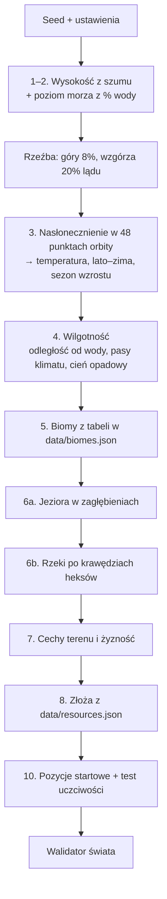

# Generator świata

**W jednym zdaniu:** z seeda, planety (oś, rok, gwiazda, orbita) i kilku ustawień buduje pierwszy świat na kuli: ląd i morze, klimat z porami roku, biomy, rzeki, jeziora, żyzność, złoża i pozycje startowe plemion.

**Faza tury:** żadna. Działa raz, przy tworzeniu nowej gry (`GameState.CreateNew(settings, content, out report)`), przed pierwszą turą.

## Dane wejściowe i wyjściowe
- Czyta: `GameSettings` (seed, wymiary, liczba cywilizacji, `WorldType`, `WaterPercent`, `Planet`, `Moisture`, `Inland`, `Relief`, `Resources`; tabela w GDD 3), zawartość z `data/biomes.json`, `data/resources.json` i `data/planets.json` (presety: dwie z czterech wielkości jasność, odległość, rok, światło, oraz atmosfera, `PlanetSetup`).
- Zmienia: wszystkie warstwy mapy Ziemi (`WorldMap`), strumień losowy `World`, pole `StartCell` każdej cywilizacji.
- Zwraca: `WorldGenReport` (procent wody, liczba rzek i jezior, liczba pól każdego biomu i złoża, starty, ich odległość i uczciwość, czas).
- Publikuje w migawce: nic nowego. Mapa idzie do widoku przez zwykłe fragmenty 32×32 (wszystkie oznaczone jako zmienione).

## Przepływ

## Zasady i wzory
Kolejność kroków jest ta sama co w GDD, rozdział 3. Wszystko liczymy na liczbach całkowitych, więc ten sam seed daje tę samą mapę na każdym komputerze.

1. **Ląd i morze.** Najpierw zarodki kontynentów: kilka losowych środków na kuli (kontynenty 5–6, pangea 1, archipelag 18–24), oddalonych od siebie,
    każdy z losowym promieniem. Wysokość to w 55% bliskość najbliższego zarodka (płaska we wnętrzu lądu) i w 45% szum. Bez zarodków szum 3D
    łączył prawie cały ląd w jedną masę (pomiar na 6 seedach: największy ląd miał 90–99% lądu); teraz typ „kontynenty” daje 2–5 osobnych lądów.
    Każde pole ma swój punkt na kuli (szerokość z równych powierzchniowo rzędów, długość z kolumny). Szum (`SphereNoise`, 3D, liczby stałoprzecinkowe) jest próbkowany w tym punkcie, więc kontynenty przechodzą przez szew i przez bieguny bez śladu (ADR 0012).
    Wysokość to suma 5 oktaw szumu. Typ świata zmienia skalę pierwszej oktawy: pangea ma 2 duże „plamy” na szerokość mapy, kontynenty 5, archipelag 10 (i ostrzejszy kontrast).
2. **Poziom morza.** Liczymy histogram wysokości i ustawiamy próg dokładnie tak, żeby woda zajęła zadany procent pól (domyślnie 60%). Woda dostaje wysokości 0–99, ląd 100–255 (poziom morza = 100, jak w GDD).
3. **Rzeźba.** 8% najwyższego lądu to góry, kolejne 20% to wzgórza (ustawienie górzystości: płaska 4+12%, górzysta 14+26%).
4. **Temperatura i pory roku** (etapy 1b i 1c-A, `ClimateModel`, `Insolation`, `EnergyBalance`, ADR 0014): dla każdej szerokości liczymy dobowe
   nasłonecznienie w 48 równych odstępach czasu na orbicie (deklinacja z nachylenia osi, odległość od gwiazdy z mimośrodu i prawa Keplera,
   ilość światła `S = L / d²` z gwiazdy i odległości, `StarOrbit`). Trygonometria i cała matematyka klimatu są na liczbach całkowitych
   (`FixedTrig`, `FixedLog`, iloczyny 128-bitowe), więc mapa jest identyczna na każdym komputerze.
   - **Średnia temperatura** z bilansu energii w 90 pasach o równej powierzchni (Budyko–Sellers, North 1975):
     `F(x)·(1 − albedo) = A + B·T − d/dx[D(x)·(1 − x²)·dT/dx]`, x = sinus szerokości. A = 203,3 − 2,09 · (cieplarniany − 33), B = 2,09 W/m²/K,
     D = 0,3 · (1 + 3 · (1 − x²)²) · √(ciśnienie w barach) (szybciej w tropikach), albedo 0,32 + 0,16 · P₂(x), lód 0,62 poniżej −10 °C.
     Rozwiązanie: układ trójprzekątniowy (algorytm Thomasa) 40 razy, z łagodną poprawką lodu. Ziemia: równik 27 °C, 45° 10 °C, 60° −4 °C, biegun −22 °C.
     Temperaturę pola bierzemy z pasa (interpolacja liniowa po sinusie). Szerokość jest „wygięta” szumem (do ok. 13°), więc strefy klimatu biegną falistymi liniami. Dalej: minus do 20 °C
     za wysokość, plus mały szum ±4 °C.
   - **Różnica lato–zima:** `121 °C × (najjaśniejszy − najciemniejszy punkt roku) × kontynentalność × współczynnik roku`, najwyżej 120 °C.
     Kontynentalność: 25% nad wodą, 35% na wybrzeżu, rośnie do 100% sześć pól standardowych w głąb lądu. Współczynnik roku: `rok · 1,5 / (rok + 0,5)` (Ziemia 1, Uran 1,49).
     Siła pór roku wynika z ciśnienia: `100% · √(1 bar / ciśnienie)` (20–150%; Mars-preset ok. 10 bar: 32%).
   - **Atmosfera z cyklu węglowego** (`CarbonCycle`, decyzja Patryka z 2026-11-05): wulkany dają CO₂ (`volcanism`, % Ziemi), wietrzenie je zabiera:
     `(CO₂ / 280 ppm)^0,3 × średnia po pasach z T > 0 °C z 2^((T − 15) / 10)`, znormalizowane do Ziemi. CO₂ na starcie to równowaga (bisekcja po logarytmie,
     24 kroki, każdy z pełnym bilansem energii). Cieplarniany: 33 °C + 1,8 °C na podwojenie CO₂ do 0,01 bar, potem 4,7 °C na podwojenie (gruba atmosfera).
     Ciśnienie = pozostałe gazy (`otherGases`, Ziemia 1 bar) + CO₂. CO₂ ręcznie (`--co2`, `--greenhouse`) wyłącza cykl.
     Wyniki (seed 42): Ziemia 280 ppm, 33 °C, średnio 14,6 °C; Mars (1,524 AU, wulkanizm 1000%) 9,05 bar CO₂, 88,5 °C, równik 9 °C, biegun 1 °C;
     Uran (rok 84 przy S = 1: gwiazda 1365 L☉, 7,14 M☉, 36,9 AU) 756 ppm, średnio 14,6 °C, równik 13,6 °C, biegun 15 °C.
   - **Sezon wzrostu:** część roku (rok jak sinusoida wokół średniej) z temperaturą między 5 °C a 45 °C.
   - **Długie zimy** (trudniejszy wariant symulacji, decyzja Patryka z 2026-11-05): martwa pora trwa `(100% − sezon wzrostu) × rok`. Gdy jest dłuższa niż
     `survivableDeadSeasonYears` (0,75 roku, `data/population.json`), dzika żywność spada proporcjonalnie. Na Uranie (zimy po kilkadziesiąt lat)
     plemiona ledwo przeżywają; technologie przechowywania podniosą ten próg.
   - Wyniki dla Ziemi: równik 28 °C, 45° ok. 14 °C, 60° ok. −4 °C, biegun −27 °C; Syberia (60°, w głębi lądu) waha się o ok. 40 °C.
     Uran: bieguny ok. 28 °C średnio, ale z wahaniem 120 °C i sezonem wzrostu ok. 22% roku; równik ok. 8 °C.
5. **Wilgotność** (0–100): bazowo 90, minus wysychanie w głębi lądu (`InlandDrying`): za każde pole od wody ubywa wilgotności, aż do limitu.
   Odległość liczymy w polach mapy standardowej (`odległość · 258 / szerokość mapy`), więc na mapie ogromnej środek kontynentu nie jest suchszy tylko dlatego,
   że ma więcej pól. Ustawienie „wilgotność w głębi lądu” (`--inland`): normalna −3 za pole, najwyżej 12 pól (−36); sucha −4, najwyżej 15 pól (−60, jak przed tym ustawieniem);
   wilgotna −2, najwyżej 10 pól (−20, lasy sięgają głęboko w ląd). Do tego pasy klimatu (mokry równik +20, suche zwrotniki −22, wilgotniejsze średnie szerokości +5, suche bieguny −10), liczone z tej samej wygiętej szerokości
   i przechodzące płynnie jeden w drugi (bez skoków), oraz **cień opadowy**: jeśli w 5 polach pod wiatr stoją góry, od −31 (tuż obok) do −11 (5 pól dalej);
   wiatr patrzy po lekko ukośnej linii. Szum wilgotności ma dwie skale: ±14 (duże plamy) i ±8 (drobne). Wiatr wieje ze wschodu w tropikach i przy biegunach, z zachodu w średnich szerokościach. Ustawienie wilgotności dodaje −15 (sucha) albo +15 (mokra); mokry świat ma też więcej rzek, bo więcej wody spływa.
6. **Biomy.** Woda: wybrzeże (1 pole od lądu), płytkie morze (2–3 pola), głęboki ocean (dalej). Ląd: pierwszy biom z `data/biomes.json`, którego zakres temperatury i wilgotności pasuje (kolejność w pliku ma znaczenie). Bagno tylko na płaskim. Gdy nic nie pasuje: łąka.
   Pory roku (etap 1b): ląd, którego lato nie przekracza 0 °C, jest lodem; sezon wzrostu poniżej 15% roku daje tundrę; wahanie lato–zima
   ponad 40 °C obniża wilgotność branego biomu o połowę nadwyżki (lasy ustępują stepom i pustyniom). Rzeki nie zaczynają się na lodzie
   i nie płyną przez narożniki rzędów polarnych.
7. **Jeziora.** „Zalewamy” mapę od morza w górę (priority flood). Pole, które leży co najmniej 2 jednostki poniżej poziomu, z którego woda by się wylała, należy do zagłębienia. Zagłębienie do 40 pól staje się jeziorem; większe zostaje suchą niecką.
8. **Rzeki** płyną po krawędziach heksów, czyli między narożnikami. Ten sam „zalew” na grafie narożników daje każdemu narożnikowi jeden kierunek w dół, który zawsze kończy się w morzu albo jeziorze. Każdy narożnik zbiera „deszcz” (średnią wilgotność swoich trzech pól), a woda spływa w dół i się sumuje. Krawędź, przez którą płynie co najmniej 2500 jednostek, ma rzekę: wielkość 1, od 3× tej ilości wielkość 2, od 8× wielkość 3. Rzeki zawsze leżą między dwoma polami lądu.
9. **Cechy terenu.** Pole lodowe na wodzie o temperaturze ≤ −8 °C. Rafa na ciepłym (≥ 24 °C) wybrzeżu lub płytkim morzu (szansa 1/6). Oaza na płaskiej pustyni (1/40).
10. **Żyzność** (0–100): bazowa z biomu, +25 przy słodkiej wodzie (rzeka na krawędzi, sąsiednie jezioro, oaza), −10 na wzgórzach, najwyżej 10 w górach, ±8 losowo. Woda ma 0.
11. **Złoża.** Dla każdego złoża z `data/resources.json` i każdego pasującego pola (biom + rzeźba): szansa `perThousandCells / 1000`, mnożona przez ustawienie złóż (skąpe 60%, bogate 160%). Zasobność losowa z zakresu, głębokość z pliku (0 widać od razu, 1–2 po technologii). Jedno złoże na pole; złoża wcześniej w pliku mają pierwszeństwo.
12. **Pozycje startowe.** Kandydat to pole lądu bez gór, 0–32 °C, z jedzeniem biomu ≥ 2 i słodką wodą. Ocena = jedzenie + woda + widoczne złoża w promieniu 3 pól (GDD 3, krok 10). Najpierw uczciwość: bierzemy tylko kandydatów z oceną ≥ 80% najlepszego. Potem rozrzut: pierwszy start to najlepsze pole, każdy następny to kandydat najdalej od już wybranych. Jeśli starty wychodzą za blisko siebie (mniej niż połowa boku „działki” lądu na cywilizację), obniżamy próg uczciwości do 70, 60, 50% i w końcu bierzemy wszystkich kandydatów. Gdy i to nie wystarcza (mała mapa, mało dobrej ziemi), luzujemy zasady kandydata: najpierw dowolny ląd bez gór, potem dowolny ląd.

**Cuda natury** (krok 9 GDD) są w rozdziale 16 GDD oznaczone jako „Moduł”, więc ich nie robimy. Generator ma na nie miejsce między złożami a startami.

**Kierunek rzeki** nie jest jeszcze zapisany w mapie (tylko wielkość na krawędzi). Wynika z wysokości narożników i dopiszemy go, gdy będzie potrzebny (transport rzeczny, tamy).

## Pliki danych
- `data/biomes.json`: 14 biomów, ich rodzaj (ląd albo jeden z 4 rodzajów wody), zakresy temperatury i wilgotności, koszt ruchu, bazowa żyzność, jedzenie i kolor podglądu.
- `data/resources.json`: 22 złoża z biomami, rzeźbą, częstością, zasobnością, głębokością i kolorem.
- Oba pliki sprawdza `ContentLoader` przy starcie i zgłasza wszystkie błędy naraz (powtórzone klucze, złe zakresy, kolory, nieznane biomy, brak któregoś rodzaju wody, brak łąki).

## Epoki lodowe i klimat w trakcie gry (etap 1c-B, ADR 0015)
- `ClimateCycles`: orbita w roku gry *t*: nachylenie `nachylenie + 1,2° · cos(2πt / 41 000)`, mimośród `mimośród + 0,010 · (1 − cos(2πt / 405 000)) + 0,011 · (1 − cos(2πt / 100 000))`,
  peryhelium `270° + 360° · t / 23 000`, jasność gwiazdy `L · (1 + zmienność · sin(2πt / okres))`. Gra zaczyna się w t = 0, czyli w ciepłym momencie.
- Lądolód każdej półkuli (Paillard 1998): napęd `f` = słońce półrocza letniego na 65° w odchyleniach od średniej (400 próbek co 1000 lat);
  stany ciepły → zlodowacenie (`f < −0,75`) → pełne (`objętość > 0,8`) → ciepły (`f > 0`); `dv/dt = (cel − v) / τ − f' / 25 000 lat`,
  cel 0 i τ = 10 000 lat w okresie ciepłym, cel 1 i τ = 50 000 lat w zlodowaceniu, `f' = (f + √(4 + f²)) / 2 − 1`.
- Udział lodu = `objętość / 0,9 × możliwość półkuli`; możliwość z lata na 65° na starcie (średnia + połowa wahania przy 70% kontynentalności):
  100% przy 5 °C i mniej, 0% przy 15 °C i więcej. Brzeg lądolodu `70° − 30° × udział`, pokrycie pasa `ląd pasa × min(1, 3 × udział)`, albedo 0,75.
  CO₂ = CO₂ planety × (1 − 0,32 × największy udział).
- `ClimateSystem` (pierwszy w fazie świata) co `updateYears` (500): przesuwa lód, rozwiązuje bilans energii z lądolodami i dla każdego pola liczy
  temperaturę, wahanie, sezon wzrostu (`CellClimate`), a dla lądu biom. Warstwy `climate_sine`, `temperature_offset`, `continentality` zapisuje generator.
- Wynik (seed 42, standard, 2220 tur = 111 000 lat): średnia 14,5 → 9,5 °C, lód północ 0,78, południe 0,86, CO₂ 203 ppm, ludzi ok. 10 500 → 7 700.
  Mars: −4,6 °C. Uran: brak epok lodowych.
- **Poziom morza** (`SeaLevel`, etap 1c-C): cel `100 + round((70 m × stopiona część lodu lądowego ze startu − 120 m × średni udział lądolodu) / 40 m)`;
  lód lądowy ze startu (`ClimateState.StartLandIce`) to liczba pól lądu z biomem lodu po wygenerowaniu świata; przy zmianie `SeaLevel.Apply` zamienia pola morza
  z wysokością ≥ poziomu w ląd i pola lądu z wysokością < poziomu w morze, czyści rzeki, właściciela i cechy zalanych pól, liczy rodzaje wody
  od nowa (BFS od lądu), przenosi osady z zalanych pól (`SettlementAssets.Relocate`, najbliższe suche pole w promieniu 30), zostawia ruiny pod wodą
  i zapisuje wpis w kronice. Potem `ClimateSystem` mierzy udział lądu w pasach od nowa. Lód morski: `ClimateSystem.Apply` ustawia cechę
  `IceField` na morzu przy średniej ≤ −8 °C i zdejmuje ją przy cieplejszej (ta sama reguła co w generatorze).
- Tryb bez okna: `--stats` ma kolumny `mean_temp_c`, `ice_north_permille`, `ice_south_permille`, `co2_ppm`, `sea_level_m`; `--png` zapisuje biomy i temperaturę
  na końcu przebiegu (`_turnN_biomes.png`, `_turnN_temperature.png`); `--star-variability`, `--star-cycle`.

## Pory roku na żywo (ADR 0013)
- `SeasonSystem` (faza 1, świat) działa tylko, gdy krok roku planety (`rok / stepsPerYear`) trwa co najmniej `minStepMonths` (dane: 8 kroków, 12 miesięcy).
- Temperatura pola w kroku *k* roku: `średnia + wahanie × (nasłonecznienie_k − średnie) / (max − min)` na szerokości pola. Dzięki temu na planecie
  leżącej na boku każda półkula ma po kolei długie lato i długą zimę.
- Warstwy `season_temperature`, `season_growth` (bieżąca tura) i `next_season_temperature`, `next_season_growth` (następna, dla AI).
- Zbieranie: `winterFoodPercent + (100 − winterFoodPercent) × wzrost_tury`; kara za długie zimy z trybu uśrednionego wtedy nie działa (zima jest prawdziwa).
- AI plemion (`GovernorAdvisor.Comfort`): wartość miejsca = jedzenie (średnia z tej i następnej tury) × wygoda temperatury (granice −5 °C i 38 °C, 2% za stopień,
  najmniej 5%; temperatura następnej pory roku albo zimowa przy porach uśrednionych; efekt `cold_tolerance` obniża granicę zimna).
- Wynik na Uranie (seed 42, 2000 tur = 21 000 lat): ok. 6300 ludzi, wszyscy żyją; obozy trzymają się pasa wokół równika, a środek populacji
  przesuwa się z każdym rokiem planety; w turach zmiany pory roku widać serie przeprowadzek. Wysokie półkule mają latem ponad 80 °C, a zimą −30 °C.
- **Siła pór roku** (dawniej ustawienie `seasonStrength`, od etapu 1c-A wynika z ciśnienia, patrz krok 4): mnoży różnicę lato–zima. Pomiar na Uranie (seed 42, po 400 turach):
  100% → ok. 6 100 ludzi, środek populacji 9–12°; 60% → ok. 9 500 ludzi, 21–24°, najwięcej przeprowadzek; 40% → ok. 11 900 ludzi.
  Pełnych przejść między półkulami jeszcze nie ma: pas przy równiku jest znośny przez cały rok, a AI widzi tylko 10 pól wokół obozów
  i przenosi się najwyżej o 10 pól. Dalekie wędrówki otworzą pamięć mapy (etap 3g) i wędrówki trwające kilka tur.
- PNG: przebieg z `--png` na takiej planecie zapisuje `_year.png`, czyli 8 klatek ostatniego roku (temperatura pory roku i obozy), oraz widok `seasonnow`.

## Testy
- `SeasonTests`: tylko długie lata są liczone na żywo (Uran tak, Ziemia i Mars nie), krok Urana 126 miesięcy, wolne decyzje raz na 50 lat,
  półkule mają lato i zimę na zmianę, zima obcina dziką żywność do polowania, tolerancja zimna podnosi wartość zimnych terenów.
- `SeaLevelTests` (etap 1c-C): poziom morza z lodu i ze stopionego lodu lądowego, szelfy wysychają i wracają do stanu ze startu, cieplejszy świat
  zalewa niskie wybrzeża, lód morski rośnie w zlodowaceniu i wraca do stanu ze startu, rzeki tylko między lądem, mieszkańcy zalanej osady
  przenoszą się na suchy ląd, a ruin pod wodą nie da się zająć ani ograbić.
- `ClimateCycleTests` (etap 1c-B): start w ciepłym momencie, zakresy nachylenia i mimośrodu, precesja, epoka lodowa na Ziemi przychodzi i się kończy,
  Uran bez epok lodowych, ponowne przeliczenie klimatu startowego nic nie zmienia, pełny lądolód ochładza o 3,5–7 °C i rozszerza lód i tundrę,
  przeliczenia są deterministyczne i przechodzą przez zapis.
- `StarAndAirTests` (etap 1c-A): logarytm i potęga stałoprzecinkowa, Kepler (Ziemia 1 rok, Mars 1,881), masa z jasności, strefa zamieszkiwalna,
  dowolne dwie wielkości dają trzecią, wyjście ze strefy stawia planetę na granicy, cykl węglowy (Ziemia ok. 280 ppm, dalej od gwiazdy więcej CO₂,
  więcej wulkanów cieplej, Uran inaczej niż Ziemia), gęsta atmosfera wyrównuje klimat, zasady `PlanetSetup`, stałe wartości klimatu Ziemi.
- `PlanetTests` (etap 1b): trygonometria całkowitoliczbowa, nasłonecznienie Ziemi zgodne z podręcznikowym (ok. 417 i 173 W/m²), klimat Ziemi,
  Uran z cieplejszymi biegunami i skrajnymi porami roku, dłuższy rok = większe wahania, presety i poprawne światy dla każdego presetu.
- `ContentLoaderTests`: domyślne dane się wczytują; zepsute dane zgłaszają każdy błąd.
- `WorldGeneratorTests`:
  - ten sam seed daje ten sam świat, inny seed inny; „złoty” hash mapy;
  - każdy typ świata i różne procenty wody przechodzą walidator; różne kombinacje temperatury, wilgotności, wilgotności w głębi lądu, górzystości i złóż też;
  - świat z suchym wnętrzem lądu ma mniej wilgotności niż normalny, a normalny mniej niż wilgotny;
  - **100 seedów** na mapie testowej bez błędów walidatora;
  - mapa standard ma rzeki, jeziora, ≥ 18 rodzajów złóż, ≥ 9 biomów lądowych i rozrzucone, uczciwe starty;
  - zapis i odczyt zachowuje mapę, ustawienia i starty;
  - rzeki leżą tylko między polami lądu.
- `WorldValidator` (w rdzeniu, używa go też `CivSim.Headless`): biomy zgodne z wysokością, woda bez rzeźby i żyzności, złoża tylko tam, gdzie pozwala plik danych, zasobność w zakresie, rzeki tylko między lądem, procent wody ±4, właściwa liczba różnych startów na lądzie.

## Wydajność
Pomiar w trybie Release (`--turns 0`), seedy 1–3, ten sam kontener co benchmark tur:

| Mapa | Czas generowania | Pamięć procesu |
| --- | --- | --- |
| Standard 256×160 | ok. 230–300 ms | ok. 48 MB |
| Duża 384×240 | ok. 520–540 ms | ok. 47 MB |
| Ogromna 512×320 | ok. 590–790 ms | ok. 49 MB |

Generator działa raz na grę, więc alokacje (kolejki, tablice pomocnicze) są tu dopuszczalne. Najwięcej czasu zajmują dwa „zalewy” z kolejką priorytetową i oceny startów.

## Podgląd PNG
`CivSim.Headless --turns 0 --png <folder>` zapisuje 6 obrazów: biomy (z rzeźbą, rzekami i startami w kolorze magenty), wysokość, temperatura, wilgotność, żyzność i złoża. To podgląd deweloperski z kolorowych heksów, nie grafika gry.
