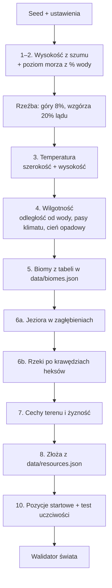

# Generator świata

**W jednym zdaniu:** z seeda i kilku ustawień (rozmiar, typ świata, procent wody) buduje Ziemię: ląd i morze, klimat, biomy, rzeki, jeziora, żyzność, złoża i pozycje startowe plemion.

**Faza tury:** żadna. Działa raz, przy tworzeniu nowej gry (`GameState.CreateNew(settings, content, out report)`), przed pierwszą turą.

## Dane wejściowe i wyjściowe
- Czyta: `GameSettings` (seed, wymiary, liczba cywilizacji, `WorldType`, `WaterPercent`), zawartość z `data/biomes.json` i `data/resources.json`.
- Zmienia: wszystkie warstwy mapy Ziemi (`WorldMap`), strumień losowy `World`, pole `StartCell` każdej cywilizacji.
- Zwraca: `WorldGenReport` (procent wody, liczba rzek i jezior, liczba pól każdego biomu i złoża, starty, ich odległość i uczciwość, czas).
- Publikuje w migawce: nic nowego. Mapa idzie do widoku przez zwykłe fragmenty 32×32 (wszystkie oznaczone jako zmienione).

## Przepływ

## Zasady i wzory
Kolejność kroków jest ta sama co w GDD, rozdział 3. Wszystko liczymy na liczbach całkowitych, więc ten sam seed daje tę samą mapę na każdym komputerze.

1. **Ląd i morze.** Siatka szumu ma proporcje zbliżone do prawdziwych proporcji mapy z heksów (wysokość rzędu heksa to ok. 1,15 szerokości kolumny), zaokrąglone do pełnych oczek, żeby szum się zawijał. Wcześniej ucinaliśmy zamiast zaokrąglać i kontynenty wychodziły rozciągnięte z północy na południe.
    Wysokość to suma 5 oktaw szumu (`IntNoise`, liczby stałoprzecinkowe). Szum zawija się na krawędziach, więc kontynenty przechodzą przez szew mapy bez szwu. Typ świata zmienia skalę pierwszej oktawy: pangea ma 2 duże „plamy” na szerokość mapy, kontynenty 5, archipelag 10 (i ostrzejszy kontrast).
2. **Poziom morza.** Liczymy histogram wysokości i ustawiamy próg dokładnie tak, żeby woda zajęła zadany procent pól (domyślnie 60%). Woda dostaje wysokości 0–99, ląd 100–255 (poziom morza = 100, jak w GDD).
3. **Rzeźba.** 8% najwyższego lądu to góry, kolejne 20% to wzgórza.
4. **Temperatura** (−30…+40 °C): `28 − 55 · szerokość²` (równik w środku mapy, bieguny na szwie), minus do 20 °C za wysokość, plus mały szum ±4 °C.
5. **Wilgotność** (0–100): blisko wody jest wilgotniej (−4 za każde pole od wody, najwyżej 15 pól), do tego pasy klimatu (mokry równik, suche zwrotniki, wilgotniejsze średnie szerokości, suche bieguny) i **cień opadowy**: jeśli w 5 polach pod wiatr stoją góry, −30. Wiatr wieje ze wschodu w tropikach i przy biegunach, z zachodu w średnich szerokościach.
6. **Biomy.** Woda: wybrzeże (1 pole od lądu), płytkie morze (2–3 pola), głęboki ocean (dalej). Ląd: pierwszy biom z `data/biomes.json`, którego zakres temperatury i wilgotności pasuje (kolejność w pliku ma znaczenie). Bagno tylko na płaskim. Gdy nic nie pasuje: łąka.
7. **Jeziora.** „Zalewamy” mapę od morza w górę (priority flood). Pole, które leży co najmniej 2 jednostki poniżej poziomu, z którego woda by się wylała, należy do zagłębienia. Zagłębienie do 40 pól staje się jeziorem; większe zostaje suchą niecką.
8. **Rzeki** płyną po krawędziach heksów, czyli między narożnikami. Ten sam „zalew” na grafie narożników daje każdemu narożnikowi jeden kierunek w dół, który zawsze kończy się w morzu albo jeziorze. Każdy narożnik zbiera „deszcz” (średnią wilgotność swoich trzech pól), a woda spływa w dół i się sumuje. Krawędź, przez którą płynie co najmniej 2500 jednostek, ma rzekę: wielkość 1, od 3× tej ilości wielkość 2, od 8× wielkość 3. Rzeki zawsze leżą między dwoma polami lądu.
9. **Cechy terenu.** Pole lodowe na wodzie o temperaturze ≤ −8 °C. Rafa na ciepłym (≥ 24 °C) wybrzeżu lub płytkim morzu (szansa 1/6). Oaza na płaskiej pustyni (1/40).
10. **Żyzność** (0–100): bazowa z biomu, +25 przy słodkiej wodzie (rzeka na krawędzi, sąsiednie jezioro, oaza), −10 na wzgórzach, najwyżej 10 w górach, ±8 losowo. Woda ma 0.
11. **Złoża.** Dla każdego złoża z `data/resources.json` i każdego pasującego pola (biom + rzeźba): szansa `perThousandCells / 1000`. Zasobność losowa z zakresu, głębokość z pliku (0 widać od razu, 1–2 po technologii). Jedno złoże na pole; złoża wcześniej w pliku mają pierwszeństwo.
12. **Pozycje startowe.** Kandydat to pole lądu bez gór, 0–32 °C, z jedzeniem biomu ≥ 2 i słodką wodą. Ocena = jedzenie + woda + widoczne złoża w promieniu 3 pól (GDD 3, krok 10). Najpierw uczciwość: bierzemy tylko kandydatów z oceną ≥ 80% najlepszego. Potem rozrzut: pierwszy start to najlepsze pole, każdy następny to kandydat najdalej od już wybranych. Jeśli starty wychodzą za blisko siebie (mniej niż połowa boku „działki” lądu na cywilizację), obniżamy próg uczciwości do 70, 60, 50% i w końcu bierzemy wszystkich kandydatów. Gdy i to nie wystarcza (mała mapa, mało dobrej ziemi), luzujemy zasady kandydata: najpierw dowolny ląd bez gór, potem dowolny ląd.

**Cuda natury** (krok 9 GDD) są w rozdziale 16 GDD oznaczone jako „Moduł”, więc ich nie robimy. Generator ma na nie miejsce między złożami a startami.

**Kierunek rzeki** nie jest jeszcze zapisany w mapie (tylko wielkość na krawędzi). Wynika z wysokości narożników i dopiszemy go, gdy będzie potrzebny (transport rzeczny, tamy).

## Pliki danych
- `data/biomes.json`: 14 biomów, ich rodzaj (ląd albo jeden z 4 rodzajów wody), zakresy temperatury i wilgotności, koszt ruchu, bazowa żyzność, jedzenie i kolor podglądu.
- `data/resources.json`: 22 złoża z biomami, rzeźbą, częstością, zasobnością, głębokością i kolorem.
- Oba pliki sprawdza `ContentLoader` przy starcie i zgłasza wszystkie błędy naraz (powtórzone klucze, złe zakresy, kolory, nieznane biomy, brak któregoś rodzaju wody, brak łąki).

## Testy
- `ContentLoaderTests`: domyślne dane się wczytują; zepsute dane zgłaszają każdy błąd.
- `WorldGeneratorTests`:
  - ten sam seed daje ten sam świat, inny seed inny; „złoty” hash mapy;
  - każdy typ świata i różne procenty wody przechodzą walidator;
  - **100 seedów** na mapie testowej bez błędów walidatora;
  - mapa standard ma rzeki, jeziora, ≥ 18 rodzajów złóż, ≥ 9 biomów lądowych i rozrzucone, uczciwe starty;
  - zapis i odczyt zachowuje mapę, ustawienia i starty;
  - rzeki leżą tylko między polami lądu.
- `WorldValidator` (w rdzeniu, używa go też `CivSim.Headless`): biomy zgodne z wysokością, woda bez rzeźby i żyzności, złoża tylko tam, gdzie pozwala plik danych, zasobność w zakresie, rzeki tylko między lądem, procent wody ±4, właściwa liczba różnych startów na lądzie.

## Wydajność
Pomiar w trybie Release (`--turns 0`), seedy 1–3, ten sam kontener co benchmark tur:

| Mapa | Czas generowania | Pamięć procesu |
| --- | --- | --- |
| Standard 256×160 | ok. 230–300 ms | ok. 48 MB |
| Duża 384×240 | ok. 520–540 ms | ok. 47 MB |
| Ogromna 512×320 | ok. 590–790 ms | ok. 49 MB |

Generator działa raz na grę, więc alokacje (kolejki, tablice pomocnicze) są tu dopuszczalne. Najwięcej czasu zajmują dwa „zalewy” z kolejką priorytetową i oceny startów.

## Podgląd PNG
`CivSim.Headless --turns 0 --png <folder>` zapisuje 6 obrazów: biomy (z rzeźbą, rzekami i startami w kolorze magenty), wysokość, temperatura, wilgotność, żyzność i złoża. To podgląd deweloperski z kolorowych heksów, nie grafika gry.
